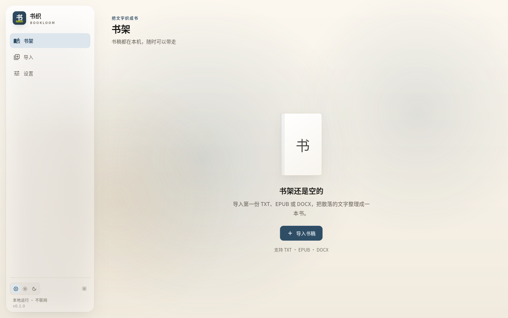

# Bookloom / 书织

本地优先的跨平台电子书工作台：导入 TXT / EPUB / DOCX，校对章节、整理元数据、生成封面，导出 EPUB 3 / EPUB 2 / DOCX / 单文件 HTML / TXT / Markdown。

- **不做账号，不上传文件**：所有解析、编辑、导出都在本机完成。
- **Linux / Windows / Android 优先**，架构上保留 macOS / iOS 的扩展位。
- **一套 Flutter UI + 一套 Dart 核心**，桌面和移动端共享业务逻辑。
- 项目代号 **Bookloom**，中文名 **书织**。

> 当前状态：**M0 脚手架已就绪**。设计系统、主题、路由、Riverpod、Drift 数据库、日志与错误边界、CI 已经落地；TXT 导入与分章在 M1 开发。



## 快速开始

要求 Flutter stable（当前验证版本 **3.47.9** / Dart 3.13.7）与 Linux 桌面构建依赖：

```bash
sudo apt install clang cmake ninja-build pkg-config libgtk-3-dev liblzma-dev

flutter pub get
dart run build_runner build          # 生成 Drift 代码
flutter gen-l10n                     # 生成多语言代码（首次或改 arb 后）

flutter run -d linux                 # 或 windows / android
flutter analyze
flutter test
```

打包：

```bash
flutter build linux --release
flutter build apk --release --split-per-abi
```

## 目录

```text
lib/
  main.dart                # 启动：bootstrap → ProviderScope → App
  app/                     # 启动、路由、全局 provider、壳层、错误处理
    bootstrap.dart         # 路径、日志、数据库、外观偏好
    router.dart            # go_router + StatefulShellRoute
    shell/app_shell.dart   # 玻璃侧栏 / 底部导航
    providers.dart         # 数据库、设置、外观控制器
  core/                    # 纯 Dart：模型、存储、路径、日志、错误、字数
    model/                 # Book / Chapter / Block / Meta / CoverOptions
    storage/               # Drift 表、数据库、settings store
    platform/              # 应用目录等平台能力
  design/                  # 设计系统：tokens / theme / components
    tokens/                # 颜色、字体、间距、圆角、动效、玻璃
    theme/                 # AppTheme + ThemeExtension
    components/            # GlassSurface / AppPage / EmptyState / BookPlate
  features/
    library/               # 书架
    import/                # 导入
    settings/              # 设置
    design_system/         # 设计系统预览页（/design）
  l10n/                    # arb + 生成代码（zh 为模板）
test/                      # 模型、字数、数据库、主题、壳层 widget 测试
docs/                      # 产品、架构、技术栈、数据、路线图、发布、开发、设计系统
```

## 关键决策

- 客户端框架：**Flutter**（Linux / Windows / Android 一致，后续可扩展 Apple）。
- 语言：**Dart 3**；重计算/格式处理优先纯 Dart，必要时通过 FFI 接 Rust/C++。
- 本地存储：**SQLite + Drift**；原始文件、图片、封面存应用数据目录，数据库只存引用。
- 内容模型：**Chapter → Block**，从第一天支持文字和图片，避免以后为插图重构。
- 视觉语言：**纸面 + 墨色 + 玻璃浮层**，见 [设计系统](docs/07-design-system.md)。
- 应用 ID：**`com.xiaoxura.bookloom`**。
- 官网/文档：**`https://bookloom.xiaoxura.com`**；`https://bl.xiaoxura.com` 作为短链跳转。
- 许可证：代码默认 MIT；第三方词典、字体、库单独列 NOTICE。

## 文档

| 文档 | 内容 |
| --- | --- |
| [产品定义](docs/00-product.md) | 定位、用户、范围、非目标、成功标准 |
| [架构设计](docs/01-architecture.md) | 分层、模块、平台适配、Isolate、数据流 |
| [技术栈](docs/02-tech-stack.md) | Flutter / Dart 选型、依赖、技术验证清单 |
| [数据模型](docs/03-data-model.md) | SQLite 表、内容块模型、备份格式、迁移 |
| [路线图](docs/04-roadmap.md) | M0–M5、验收标准、风险、第一轮任务 |
| [平台与发布](docs/05-platform-release.md) | 应用 ID、域名、打包、签名、发布流程 |
| [开发指南](docs/06-development.md) | 环境、脚手架、规范、测试、CI、移植说明 |
| [设计系统](docs/07-design-system.md) | 色彩、字体、间距、玻璃策略、组件约定、截图 |

## 开发约定

- 提交使用 Conventional Commits：`feat(import): …`、`fix(export): …`、`docs: …`。
- `main` 保持可构建；新功能走 `feat/xxx` 分支。
- 界面文案全部走 `l10n`；颜色、间距、字号全部走设计 token。
- 业务错误统一用 `AppFailure`，日志不写正文。
