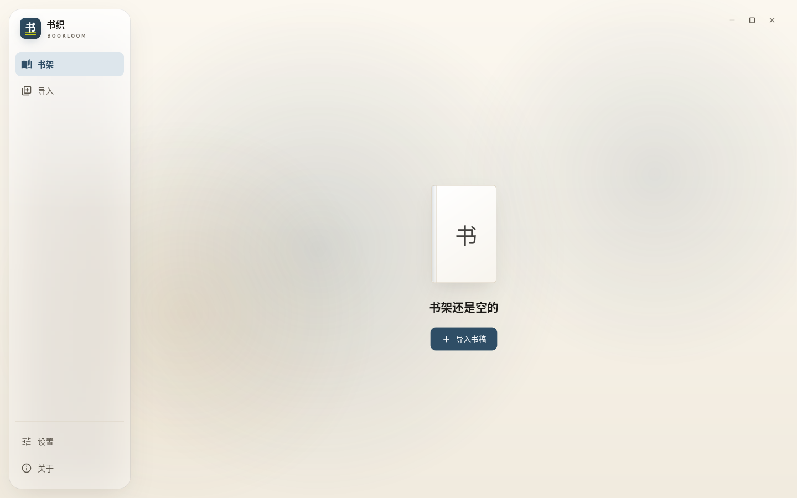
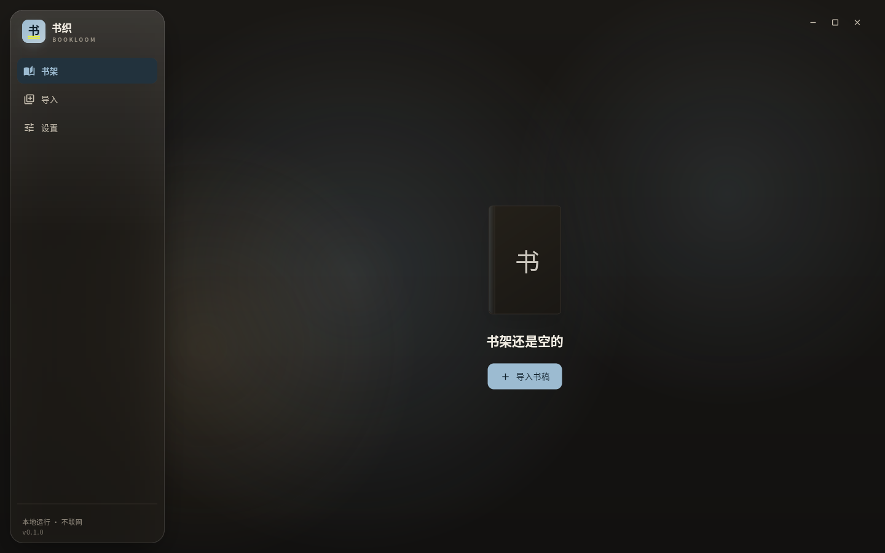
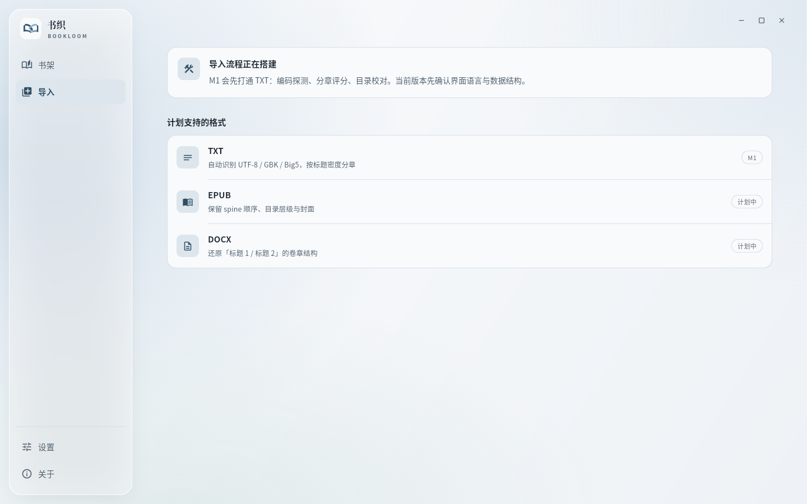
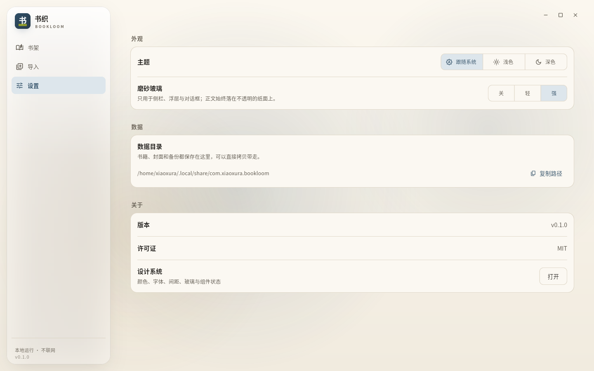
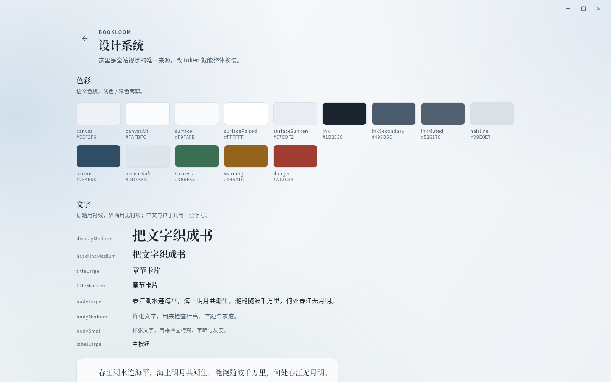
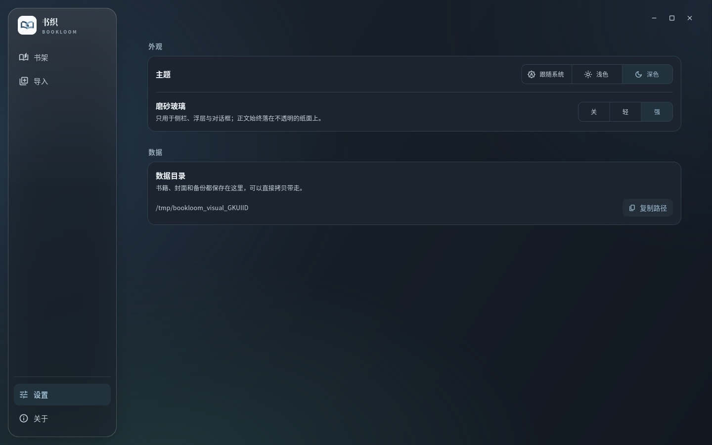
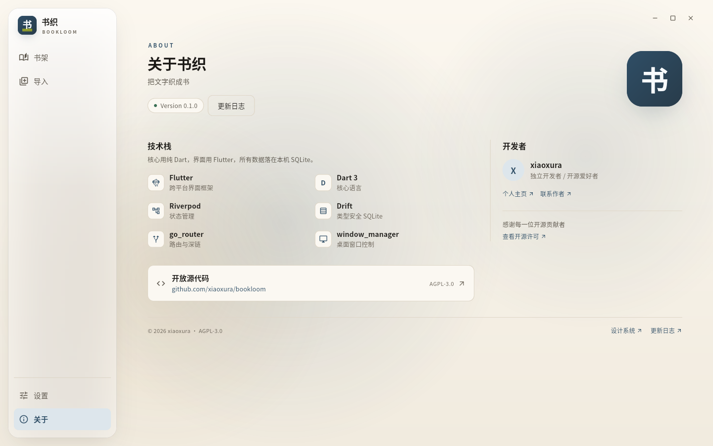
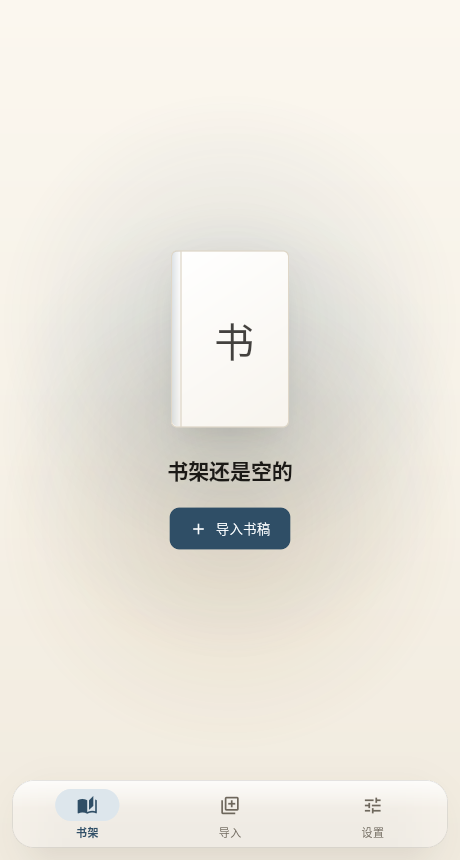

# 设计系统

> 这一页决定 Bookloom 长什么样。所有颜色、字体、间距、圆角、动效都从 `lib/design/tokens/` 出发；页面里不应该出现魔法值。



## 1. 目标与原则

1. **清晰、轻盈的阅读工作台**：雾白画布、墨色文字、极细的分隔线；信息密度服从阅读节奏。
2. **结构优先**：字号层级和间距先立住，装饰后放。避免渐变按钮、发光卡片、大面积高饱和色。
3. **玻璃是点缀，不是主题**：只有侧栏、浮层、对话框允许磨砂；正文永远落在不透明纸面。
4. **一处改，全站变**：换配色或字体，只改 token；页面组件不覆写主题。
5. **桌面与移动共享一套语言**：同一组 token、同一套组件，只切换壳层布局。

## 2. 为什么玻璃只做浮层

磨砂半透明（frosted glass）在 Flutter 里的真实成本与限制，决定了它只能当点缀：

| 问题 | 说明 | 我们的对策 |
| --- | --- | --- |
| 性能 | 每块 `BackdropFilter` 都要对背景做一次模糊；大面积、滚动中、多层叠加会掉帧 | 只给少量静态浮层用；圆角裁剪 + `RepaintBoundary` |
| 可读性 | 背景越花，文字对比越低；长文校对最忌讳灰底灰字 | 玻璃 tint 不透明度保持 ≥ 0.46（浅）/ 0.50（深），正文不放玻璃上 |
| 平台一致性 | Flutter 只能模糊「应用内」内容，做不到 Windows Mica / macOS Vibrancy 那种窗口级透明；Linux 上也没有原生毛玻璃 | 不承诺「透出桌面」，只做应用内层次 |
| 可降级 | 低端机、远程桌面、无障碍「减少透明度」 | `GlassQuality.off` 自动退化为不透明纸面，代码零改动 |
| 测试稳定 | 模糊结果依赖 GPU | 截图基准只覆盖不透明状态；golden 里关闭玻璃 |

结论：**玻璃用来提示「这是浮在上面的东西」**（侧栏、底部导航、弹出菜单、对话框），不用来表达品牌，也不用来承载正文。

## 3. Token 地图

```
lib/design/
  tokens/
    app_colors.dart      # 语义色板（light / dark）
    app_typography.dart  # 字体栈与字号级别
    app_metrics.dart     # 间距、圆角、动效、布局常量
    glass.dart           # 磨砂参数（质量档位）
  theme/
    app_tokens.dart      # ThemeExtension：context.colors / context.glass
    app_theme.dart       # Material 组件统一主题
  components/
    app_canvas.dart      # 中性底色 + 雾蓝 / 青灰色晕
    app_surface.dart     # 透明 Scaffold（提供 Material / SnackBar host）
    glass_surface.dart   # 磨砂面板
    app_page.dart        # 页面骨架：标题 / 副标题 / 操作区
    empty_state.dart     # 空状态
    book_plate.dart      # 无封面时的书封占位
```

页面里读色：

```dart
final colors = context.colors;   // AppColors
final glass = context.glass;     // GlassTokens
```

## 4. 色彩

浅色以中性雾白为底，深色是蓝黑；主色保留克制的靛青，朱砂只用于危险与提示。背景色晕使用独立的 `canvasMist` / `canvasBloom`，不再借用警告色叠出泛黄、灰脏的背景。

| 语义 | 浅色 | 深色 | 用途 |
| --- | --- | --- | --- |
| `canvas` | `#EEF2F6` | `#111820` | 页面底色（渐变底部） |
| `canvasAlt` | `#FAFBFC` | `#1A232D` | 页面底色（渐变顶部） |
| `canvasMist` | `#B7CDE0` | `#2B455C` | 靠近侧栏和右上角的雾蓝色晕 |
| `canvasBloom` | `#D8E5E4` | `#233E40` | 底部青灰色晕 |
| `surface` | `#F9FAFB` | `#1C252F` | 卡片、面板 |
| `surfaceRaised` | `#FFFFFF` | `#25303C` | 输入框、抬升层 |
| `surfaceSunken` | `#E7EDF2` | `#0F161D` | 凹陷区域、徽标底 |
| `ink` | `#1B2530` | `#EDF2F7` | 主文字 |
| `inkSecondary` | `#495B6C` | `#BDC8D2` | 次级文字 |
| `inkMuted` | `#526170` | `#96A7B7` | 提示、弱化文字 |
| `hairline` | `#D9E0E7` | `#33414F` | 1px 分隔线、描边 |
| `accent` | `#2F4E66` | `#9CBBD1` | 品牌、链接、选中态 |
| `accentContrast` | `#F7FAFC` | `#10202B` | 主色上的文字 |
| `accentSoft` | `#DDE6EC` | `#22323D` | 选中底、标签底 |
| `success` / `warning` / `danger` | `#3B6F55` / `#94641C` / `#A13C33` | `#7FB79A` / `#D3A45E` / `#DE8B80` | 状态 |

对比度由 `test/design/theme_test.dart` 守护：`ink` ≥ 7:1，`inkSecondary` / `inkMuted` / `accent` / `danger` ≥ 4.5:1。

画布色晕按视口比例绘制，主要集中在导航背后，内容区保持低对比度；静态背景独立缓存，不添加动态背景或额外的背景模糊滤镜。阅读、表单等内容面板继续使用不透明 `surface`。

### 磨砂材质

- `strong`：32px 背景模糊，浅色 tint 0.46、深色 0.50；顶部高光仅为 0.20 / 0.10，避免原先大面积白色高光遮住背景。
- `soft`：12px 背景模糊，浅色 tint 0.76、深色 0.74，适用于更安静的面板与较低性能设备。
- `off`：完全不透明的 `surface`，无模糊；组件的局部参数不能绕过关闭档。
- 明暗边缘与柔和投影表达面板厚度，保持原有的模糊层 / 内容层分离。

## 5. 文字

标题用衬线（Noto Serif CJK SC），界面用无衬线（Noto Sans CJK SC）；中文与拉丁共用一套字号，避免中英混排时基线跳动。

| Token | 字号 / 行高 | 用途 |
| --- | --- | --- |
| `displayLarge` | 40 / 1.18 | 极少用，封面/欢迎页 |
| `displayMedium` | 32 / 1.22 | 空状态大标题（备用） |
| `headlineLarge` | 25 / 1.3 | 页面标题 |
| `headlineMedium` | 21 / 1.35 | 内容标题 |
| `titleLarge` | 16.5 / 1.45 | 区块标题、品牌 |
| `titleMedium` | 15 / 1.45 | 列表项标题 |
| `bodyLarge` | 15 / 1.75 | 正文 |
| `bodyMedium` | 14 / 1.7 | 说明文字 |
| `bodySmall` | 12.5 / 1.6 | 辅助说明 |
| `labelLarge` | 13.5 / 1.4 | 按钮、导航 |
| `labelSmall` | 11 / 1.3 | 徽标、eyebrow（字距 1.6） |

阅读/编辑正文：衬线 16.5 / 1.9，字距 0.15，首行缩进 2 字符，见 `AppTypography.reading`。

编辑器视口小于 600px 时使用紧凑正文 15.5 / 1.75，章节标题使用 `headlineSmall`（18 / 1.4），标题内边距与段落间距收至 12px；其余视口保留原字号与间距。只调整编辑界面密度，不改变书稿排版配置或导出字号，也不覆盖系统文字倍率。

字体栈按平台回退：Linux 用 Noto CJK，Windows 回退微软雅黑/宋体，macOS 回退苹方/宋体。后续可内嵌字体子集，保证三端完全一致。

## 6. 间距、圆角、动效

- 间距：4 的倍数（`xxs 2 / xs 4 / sm 8 / md 12 / lg 16 / xl 24 / xxl 32 / xxxl 48 / huge 64`）。
- 圆角：控件 10、卡片 16、浮层 22、标签 999。
- 动效：`fast 120ms`、`base 200ms`、`slow 320ms`、页面 `240ms`；进入 `easeOutCubic`，强调 `easeInOutCubic`。页面切换是 240ms 淡入 + 1% 上移，不做花哨转场。
- 尊重系统「减少动态效果」：动画时长由 `MediaQuery.disableAnimations` 兜底（后续接入）。

## 7. 壳层与断点

| 宽度 | 布局 |
| --- | --- |
| ≥ 960 | 玻璃侧栏 220px + 内容区，四周留 16px，侧栏圆角 22 |
| 手机 | 内容区 + 三项悬浮玻璃底部导航（基础高 56、最大宽 320、图标 20，圆角 22，系统安全区留在面板外） |

侧栏分两组：**书架 / 导入** 在顶部，细分隔线与 **设置 / 关于** 一起压在左下角；底部不再放版本号或口号。窄屏底栏仅保留 **书架 / 导入 / 设置**，关于位于设置最底部并以可返回的页面打开；权限与访问检查位于关于之前。侧栏宽 220，导航文字 14.5/20px。

菜单页与推入页统一避让顶部状态栏，背景画布可以延伸至系统区域，文字和操作不能进入该区域；嵌套页面不重复累计安全区。底栏自身不再吃状态栏或手势区 padding，面板外只保留一份底部安全区。

手机底栏面板水平居中，三项等分可用宽度，各项图标与文字在整项触摸区域内居中；最小触摸高度不低于 48px。系统文字放大时面板随标签所需高度增长，不把用户文字倍率缩回默认值。桌面窄窗仍使用可折叠侧栏，不因窗口变窄切换为手机底栏。

### 窗口标题栏

窗口是**无边框**的（Linux 由 GTK runner 设为 undecorated；Windows/macOS 用 `TitleBarStyle.hidden`），系统那条灰色标题栏不再出现。取而代之的是 40px 高的自绘 caption：

- 只铺在**内容列**上方，侧栏保持通高 —— 左上角不会出现一条空白带；
- 整条 caption 可拖拽窗口，双击切换最大化；
- 右上角三个 30×30 按钮（最小化 / 最大化 / 关闭）跟随主题 token，关闭按钮悬停时转朱砂色；
- 窗口四边和四角有 6–14px 隐形热区，拖拽交给 GTK/Win32 处理（`window_manager` 的 `startResizing`）；Windows 保留系统的缩放边框（约 6–7px，`WM_NCHITTEST` 直接返回 `HTLEFT` 等），应用不在客户区里叠加第二层热区；
- 推入页（如 `/design`）由路由自己再挂一条 caption，保证任何页面都能拖窗口、能关窗口。

代价：窗口没有系统阴影；Linux 上圆角由合成器决定。这些在 M4 打包时再统一处理（Windows 11 自带圆角，GNOME 由 Shell 处理）。

内容列最宽 1080，页面左右内边距 32（窄屏 20）。页面滚动条贴在页面外沿（内容列之外），不压着内容列边缘，避免紧贴卡片。路由页面与壳层铺一层不可见的命中层（透明 `ColoredBox`）：`PageRoute` 背后有一个无色、不可关闭的 `ModalBarrier`，点在页面空隙会落到它并触发系统提示音（Windows 上就是「叮」的一声）。列表永远用 `ListView.builder` / `SliverList`，不整页 `SingleChildScrollView` 包长列表。

玻璃面板把「模糊底」和「内容」分成两个绘制层：模糊结果被 `RepaintBoundary` 缓存，选中态动画或墨水涟漪只重绘内容，不会每帧重跑一次背景模糊。

**切换 tab 不做转场动画**：分支用 `NoTransitionPage` 直接换页，并开启 `StatefulShellBranch(preload: true)` 预加载。理由：转场每帧都要整页重绘，还会让玻璃浮层重新做一次背景模糊，第一次切换尤其容易读成卡顿；tab 属于「即时」操作，动效只会拖慢它。推入页仍保留 240ms 内容淡入；路由最外层的完整画布立即覆盖旧页，画布本身不淡入、不位移，进入与返回时均不能透出旧文字或导航。

## 8. 组件约定

- 按钮、输入框、分段选择、开关、Chip 全部由 `AppTheme` 统一，页面不得局部覆写。
- 卡片：`surface` + 1px `hairline`，不加阴影；只有浮层与书封允许阴影。
- 空状态：`EmptyState`（图示 + 标题 + 一句说明 + 至多两个操作 + 可选提示）。标题使用无衬线 22px / 1.4、600 字重；说明 14px，图示与标题间距 16px。书架使用主题色绘制的叠放书籍图示，带书脊、书签与纸页，替代单字书封；图示不承载需要朗读的内容。
- 页面骨架：`AppPage` 支持 eyebrow / 标题 / 副标题 / 操作 / 滚动体，但**菜单页不显示标题与副标题**——当前在哪一页由侧栏选中态表达，标题重复只是噪音；推入页（如 `/design`）才用标题 + `leading` 返回键。
- 文案原则：**指导性文字保留**（设置项的一句话释义、格式能力说明、空状态的必要提示），**纯装饰性文字删掉**（和侧栏重复的页面名、复述标题的副标题、空状态里「把文字整理成一本书」这类口号）。
- 图标默认 20px，线性风格；选中态用 `accent` + `accentSoft` 药丸底。
- 设置选择器使用统一纸面填充、细边框、10px 圆角和上下箭头；标签置于控件上方，展开菜单以主题选中底和勾选标记表达当前值。保持 Material 3 菜单交互与偏好连续选择的保存语义；系统返回先关闭展开菜单，再按页面路由返回。
- 主题选项完整单行，普通手机宽度下三项可见；窄屏或放大文字时允许横向访问，不截断“跟随系统”或缩小用户选择的文字倍率。
- 权限与访问检查分别说明自身数据、用户选择的输入文件、导出目标和分享 URI 的用途。未知或检查失败不得显示为已授权，不能用全盘权限替代文件选择；测试文件只含自编标记，不包含书稿。

## 9. 怎么改视觉

1. 换配色 → 改 `AppColors.light` / `AppColors.dark`，跑对比度测试。
2. 换字体 → 改 `AppTypography` 的字族与回退栈；需要内嵌字体时再加 `pubspec.yaml` 的 `fonts`。
3. 换玻璃强度 → 改 `GlassTokens.forQuality`；关闭档必须保持完全不透明。
4. 换布局 → 改 `AppLayout`（断点、侧栏宽度、内容宽度）。
5. 新增组件 → 放 `lib/design/components/`，不依赖任何 feature。

预览入口：设置 → 设计系统（`/design`），或直接打开 `DesignSystemPage`。

## 10. 截图

| 浅色书架 | 深色书架 |
| --- | --- |
|  |  |

| 导入（保留格式释义） | 设置（保留配置释义） |
| --- | --- |
|  |  |

| 设计系统 | 深色设置 |
| --- | --- |
|  |  |

关于页采用居中的 960px 内容区：顶部标识、产品说明与版本；全宽开源仓库卡；下方为技术栈与开发者信息卡，窄屏纵向排列。技术栈的列数按卡片自身可用宽度决定（内部宽度不足 400 时收为单列），卡片纵向铺满时仍保留两列。不提供指向开源仓库的“更新日志”按钮；开源仓库入口保持明确名称。正文卡片保持不透明，底部保留版权与设计系统入口。手机从设置进入时带返回操作。



移动/窄窗（< 960）：

## 11. 品牌标识

Logo 使用交织书页图形，原始设计位于 `docs/design/brand/bookloom-logo.png`。
运行时资源位于 `assets/brand/`：透明标识用于共用 `AppMark`（侧栏与关于页），
暖纸底正方形图标用于 Linux 窗口。`AppMark` 在深浅主题均保留浅色底与原始品牌色，
不随主题重新着色；保持等比缩放，旁边已有产品名时不重复朗读装饰图像。
Android 启动器和 Windows ICO 使用同一设计的对应尺寸资源。

## 12. 编辑与书架交互补充

- 书架排序使用统一选择框的紧凑模式，手机普通字号下宽 168px、高 48px，不重复显示上方标签；与右侧“导入”按钮等高对齐，极窄屏及大字号允许换行。书架与章节搜索点击外部时取消焦点。
- 手机编辑页使用系统返回，目录入口位于标题右侧；保存状态位于书名下，撤销、重做同排。正文始终可以直接编辑，不再区分编辑／预览模式。
- 卷是无正文的目录容器，保留左侧文件夹图标，卷名后显示展开箭头，图标与文字间距收紧；点击只展开或收起，不进入编辑。章节前后导航跳过卷，移除章节与卷的升降级入口。
- 目录新增菜单支持新建卷、新建章节、批量移入卷；新章节可选择所属卷及插入位置，含一个可编辑空段落。批量移动保留相对顺序及正文，可撤销、重做。
- 移动端数据页解释应用私有存储及卸载影响，通过导出和备份取出数据，不展示无法直接访问的内部路径；桌面保留路径及复制功能。
- 编辑正文采用连续纸面和全宽段落，不逐段显示表单边框、填色、额外内边距或右侧菜单；长按选中文字的菜单优先提供“从此段拆章”“设为章节标题”，作用于当前段落，并保留复制、粘贴、全选等标准操作。撤销／重做不因输入框有焦点而禁用；撤销先提交当前组合输入，成功后显示及时反馈。没有可撤销／重做的操作时，按钮不可点击且呈淡灰色；统一图标按钮主题按禁用状态解析颜色，不能覆盖成启用色。读取焦点上下文前检查其仍然挂载。
- 多栏编辑工作台不受普通页面 1080px 可读宽度限制，目录、正文与设置按窗口可用宽度排布；普通设置和说明页保留可读宽度。校对、重新识别和成书设置使用居中、限宽且有明确关闭按钮的工作浮层，窄屏保留安全边距与键盘避让，不沿用桌面底部通栏抽屉。
- 短时反馈使用统一的浮动 Snackbar：桌面居中、最大宽度 440px，窄屏保留边距；支持文字换行、操作按钮与大字号，不以屏幕全宽深色底条承载一句提示。确认和长任务使用独立对话框，导入任务显示阶段与真实进度，未知工作量不使用虚构百分比。
- 排版设置提供即时样例，首行两字缩进属于排版而不是插入正文空格。样例、阅读预览与导出可以使用缩进；编辑组件的首行布局只有在光标、选区、组合输入和换行几何一致后才可声明支持，不以整段内边距或显示字符偏移代替。

## 13. 尚未定稿

- 字体是否内嵌（体积 vs 三端一致），M2 前决定。
- 图标集：先用 Material 线性图标，后续可换 Lucide/Phosphor 以统一笔画粗细。
- 封面编辑器的取色与模板，随 M2 封面功能单独设计。
- 高对比度模式（`MediaQuery.highContrast`）待接入。
